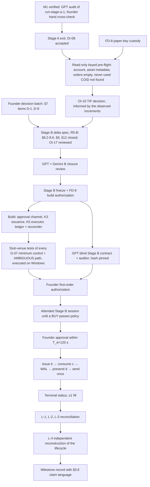

# SL-PT-001 Strike 7: Stage B execution front (planning only)

**From:** Claude (Implementation Lead) | **To:** Founder | **CC:** GPT (Independent Auditor)
**Date:** 2026-11-26, written during `run-stage-a-1` | **Base:** repo `f02a924`; frozen R4.2i (`42595511…`); G-07 Draft 0.3; Readiness D1–D8 as classified by the R3 Closure Package §1.3; decision records v1–v5
**Status:** PLANNING. Nothing here is authorized or built. No credentials. No orders. The Stage A run, harness, policy, scheduler, chain and custody files are untouched.
**FD-6 / v5 note:** this document describes harness reuse only at the level of spec sections. It contains no harness code or internals, so it can go to GPT.
**Stage A success is not presumed.** Every step after §4 S2 is gated on M1 passing.

---

## 1. Bottom line

1. **About 70% of Stage B is already specified.** R4.2i §8.2–§8.6, §9 and §12 are drafted. G-07 Draft 0.3 defines the execution boundary (K3, K5, LP-CONSUME / LP-WAL / LP-PRESEND, I1–I10). The D7 runbook is retained in part. The Stage A pipeline (§3–§7, §10) carries over unchanged. Stage B is a **delta specification plus three new components**, not a new design.
2. **The binding constraint is time, and the human approver is the reason.** R4.2i §5.3 gives the founder from `created` (at most T_d + 30 s) to **T_d + 120 s** to approve. That is a 90–120 s window, and it opens only when a BUY crossover fires. That cannot happen by chance. Stage B needs an **attended-session model and an approval channel built for that window.** Neither is specified anywhere yet (§3, B-1).
3. **The fill is not guaranteed even if everything works.** §7.2 rounds the BUY limit *down* from the ask. If the venue's price increment is $1, the order rests below the ask, and an IOC order will very likely not fill. The TIF decision (OI-10) therefore decides whether the milestone is reachable. It should be made **after** a read-only pre-flight observes the real increment, and not changed by editing §7.2, which is a Stage A section and would force a new Stage A freeze (§3, B-3).
4. **Shortest compliant path:** M1 → Stage A exit → founder decision batch → narrow keyed read-only pre-flight → TIF → Stage B freeze → build and stub tests → Stage B auditor pinned → attended session to first fill → reconcile → independent reconstruction. Nine gates, detailed in §4.

---

## 2. Minimum Stage B dependency graph

**Critical path:** M1 → AX → PF → TIF → SPEC → REV → FRZ → BUILD → STUB → GO → SESS. Everything to the right of SESS depends on the market (U-O3, UNBOUNDED).

**Off the critical path (can run in parallel):** the founder decision batch (start now); the GPT auditor (after FRZ, parallel with BUILD); drafting the delta spec (start now, but freeze only after PF and TIF).

---

## 3. Primary attack surface: the authorization-to-execution boundary

Each step has a current specification, the components it reuses, and what is still missing. **[M]** marks a mandatory blocker and **[O]** an optional improvement.

| # | Step | Specified in | Reuses | Gap |
|---|---|---|---|---|
| 1 | Admissible BUY proposal | R4.2i §3–§7, §8.1.1 (frozen) | the entire Stage A decision pipeline, unchanged | **[M] B-2:** sizing must read the *reconciled* Stage B ledger (§8.2) instead of shadow cash. Draft text exists; OI-17 is unreviewed |
| 2 | Explicit founder approval | §9.1 (draft) | the chain as K3 store | **[M] B-1:** there is no approval channel, notification or attended-session model. **[M] B-4:** approver authentication has no decision ID (see defect D-x1) |
| 3 | Bind approval to one exact order | §9.1 bound fields; §9.2 issuance predicate; G-07 §2 context binding (PT-A3) | canonical serialization and hashing (§10.5) | **[M]** add executor_id, venue, action type and not_before to the record (PT-A3) |
| 4 | Prevent duplicate or unauthorized submission | G-07 I3 (single consumption), I10 (one COID per authorization; no retry), §2 (no trigger path; K5 polls) | append lock and single-writer discipline (§6.3) | **[M]** FD-G16 = (a), no resubmission (GPT and Claude both recommend it). **[M]** COID = deterministic from auth_id (FD-G6) |
| 5 | Transmission to the paper endpoint | §9.3 checkpoints (c)/(d), §9.4 δ_send, G-07 §1 LP-PRESEND | quote validity Q1–Q5 and freshness R4 at each checkpoint; the bar re-fetch (§4.9) | **[M]** δ_send value (FD-G18). **[M]** a K5 process is the only holder of keys, with the paper trading host on its allowlist and not on the decision process's allowlist |
| 6 | Receipt and reconciliation | §8.4 fills, §8.5 atomicity, §12 L-1 to L-3; G-07 I2 independent decode of the echoed order | the chain as single-writer ledger | **[M]** FD-G17 reconciliation path. **[M]** fee asset, fill-id field and paper fee rate are UNVERIFIED (U-V3). The first reconciliation must accept whichever the venue reports, so §8.4 already branches on fee in BTC and fee in USD |
| 7 | Independent reconstruction | milestone §0.1; §12 L-4 | the FD-6 custody pattern (commit-reveal, pinned hash, blind author) | **[M] OI-15:** who does it. The Stage A auditor covers cycles only |

### 3.1 Findings on the boundary (new in this package)

**B-1. The approval window needs a human-presence model.** [M]
- R4.2i §5.3: approval_deadline = T_d + 120 s, and the cutoff guarantees at least 90 s for any proposal presented. BUY crossovers on 5-minute SMA-20/50 are intermittent, and their timing is UNBOUNDED (U-O3).
- An unattended proposal simply dies as EXPIRED_UNAPPROVED. That is safe, so the minimal compliant model is: **Stage B runs only in founder-attended sessions.** Proposals outside a session expire harmlessly.
- What's needed:
  - an alert at proposal time, local and audible;
  - a one-command approval that writes the approval record bound to the exact proposal hash;
  - a session start and stop command.
- Nothing else is needed. No push service, no mobile channel. Both would be speculative expansion.

**B-2. Pre-approval reconstruction cannot fit in the window as written.** [M, decision]
- D7 step 2 (RETAINED / UNVERIFIED, U-O1) asks for an independent recomputation of D(k−1) and D(k) *before* approval, inside 120 s. Running a blind auditor inside that window is not credible.
- **Proposal:** before approval, the founder reads the harness's own TER summary (signal, L, q, R, rule results). The independent reconstruction applies to the whole lifecycle *after* the terminal state, which is what §0.1 requires.
- Founder decision D-5. If the founder keeps step 2, the window becomes the dominant feasibility risk.

**B-3. TIF decides whether the milestone can be reached at all.** [M]
- §7.2 sets the BUY limit L to the ask rounded *down* to price_increment.
- With a $1 increment (DOCUMENTED; the docs contradict themselves, U-V1), L is below the ask by up to $0.99. Paper fills at NBBO (DOCUMENTED, forum staff), so:
  - **IOC** → very likely no fill;
  - **GTC with a Sentinel cancel no later than the ceiling (T_d + 180 s)** gives the ask up to roughly 60–150 s to touch L.
- With a fine increment, L is close to the ask and IOC probably fills.
- **GTC adds machinery.** The cancel is a consequential action (G-07 I1), so it needs its own CANCEL authorization, its own LP path, and handling for an ambiguous cancel.
- **Sequencing fix:** decide TIF *after* the pre-flight observes `price_increment`. Do **not** change §7.2, since it is a Stage A section and editing it would force a new Stage A freeze.
- A zero-fill terminal BUY is a valid governed attempt but does not meet the milestone (§0.1).

**B-4. Inconsistent decision reference (spec defect, Claude's).** [M, editorial]
- R4.2i §9.1 says "Approver authentication is UNVERIFIED (FD-G13)". G-07 Draft 0.2a defines FD-G13 as "proceed to Stage B knowing G7-I8 does not hold".
- These are two different decisions. Approver authentication (U-G1) needs its own ID. Fix at the Stage B freeze.

**B-5. D7 precondition conflicts with CF-7.** [resolved by precedence]
- D7 lists "Stage C query-by-COID and duplicate-COID tests executed on paper" as a precondition. CF-7 (a recorded decision) says the first order is the first governed order, the duplicate-COID test comes later, and only a never-used-COID not-found query happens in pre-flight.
- **CF-7 governs.** The duplicate-COID test is off the critical path.

**B-6. Single host simplifies the clock.** [simplification]
- If K3 and K5 run on the same machine and read the same OS clock, the K3–K5 skew σ is 0 by construction. The only clock relationship left is to the venue, and §5.6 already bounds that (≤ 2 s).
- This reduces FD-G18 to choosing δ_send, plus a statement that σ = 0 under a single-host deployment, which must be withdrawn if the deployment ever splits.

**B-7. Chain continuity is a decision, not a default.** [M, decision]
- The global chain's GENESIS pins the R4.2i frozen set, and the harness accepts only a closed set of record types.
- Stage B adds record types: APPROVAL, AUTHORIZATION, CONSUME, WAL, PRESEND, SEND, ORDER_UPDATE, FILL, LEDGER and RECONCILE.
- **Option (i):** append to the same chain under a new harness version and manifest. Continuity is preserved, but the Stage A auditor's population rules must ignore the new types.
- **Option (ii):** a new chain with a Stage B GENESIS. The populations are clean, at the cost of an extra anchor.
- Recommendation: (ii). Stage A evidence stays sealed and auditable exactly as pinned.

---

## 4. Proposed implementation sequence

Gates are founder records. Nothing starts before its gate.

| Step | Work | Owner | Gate in | Notes |
|---|---|---|---|---|
| **S0 (now)** | this plan; the decision batch (§7) put to the founder; Stage B delta spec drafted as a **diff against R4.2i §8.2–§8.6, §9, §12 only** | Claude | Strike 7 | no Stage A section may change; any such need is escalated, not edited |
| **S1** | founder decides D-1 to D-9 (§7) | Founder | — | can happen during or right after the run |
| **S2** | M1: GPT's auditor v2.3 on run-stage-a-1 after RUN_CLOSE and scope.json, seed reveal, founder hand cross-check; the Stage A exit report; OI-08 accepted or not | GPT, Founder; Claude drafts the exit report | RUN_CLOSE | **If M1 fails, stop here.** Stage B spec work is kept; building waits for a Stage A remedy |
| **S3** | FD-8 key custody, then the **read-only pre-flight**: account (1×, shorting off, buying power, cash), asset metadata (`price_increment`, `min_order_size`, qty increment), orders list (expected empty), never-used COID query (expected not found). Recorded raw | Founder runs; Claude supplies a `.ps1` | **new narrow authorization: D-9** (credentials, read-only, no order endpoint) | resolves U-V1, U-V2, U-V5, U-V6; produces the increment data for TIF |
| **S4** | TIF decided; delta spec finalized; GPT and Gemini B closure review (diff packet, per the efficiency rule in the convergence SITREP); OI-17 closed; **Stage B freeze**; **FD-9** | Claude drafts; GPT, Gemini B; Founder | S2 and S3 complete | — |
| **S5** | build: approval channel and session control; K3 issuance at (b); K5 executor (poll, (c), LP-WAL, (d), send once, AMBIGUOUS → query by COID only); typed ledger; reconciler L-1/L-2/L-3; independent decode of the echoed order | Claude | FD-9 | decision pipeline reused unchanged; key-holding code isolated in K5 |
| **S5′** (parallel) | GPT writes the blind Stage B contract and auditor (lifecycle reconstruction, L-4) from the frozen Stage B set; its hash is committed before the first order; seed and commit-reveal as in FD-6 | GPT | Stage B freeze | per v5, GPT sees no harness code |
| **S6** | stub-venue tests of every G-07 "yes" row (D6) and the AMBIGUOUS path (CF-7 step 1); run on Windows; logs committed | Claude builds; Founder runs | S5 | each result carries the G-07 §9 record fields |
| **S7** | founder authorizes the first order (the last gate, P23); attended session(s); first BUY that passes policy → approve → order → terminal | Founder | S5′ + S6 | no forced entry; zero-fill attempts are logged, not retried |
| **S8** | reconcile L-1 to L-3; push; L-4 by the OI-15 reconstructor; milestone record with §9.8 claim language verbatim | Founder, reconstructor; Claude drafts | terminal state | — |

**Earliest feasible order:** after S6. It is not schedulable beyond that point, because it waits for a BUY signal during an attended session.

---

## 5. Inventory of reusable work

| Asset | Reuse | Change needed |
|---|---|---|
| R4.2i §3–§7, §8.1.1, §10, §11 (frozen) | as-is: strategy, data contract, quote validity, timing, policy P-0.2, sizing, chain model | none (any change forces a new Stage A freeze) |
| Stage A harness: exact arithmetic, validation, decision and policy core, chain append and lock, scheduler wrapper | the decision process of Stage B (K2/K3 side) | new record types and the approval/issuance step; **no keys in this process** (the V12a check is kept) |
| R4.2i §8.2–§8.6 typed ledger, fills, atomicity, invariants | the Stage B ledger text | review OI-17; wire sizing to the reconciled cash |
| R4.2i §9.1–§9.7 approval, issuance, checkpoints, δ_send, TIF, first-order sequence, STOP table | the Stage B boundary text | fill in TIF, δ_send, the approver-auth ID (B-4), the attended model (B-1) |
| R4.2i §9.8 claim language | verbatim in the milestone record | none |
| R4.2i §12 L-1 to L-4 | reconciliation spec | FD-G17 path named |
| R4.2i §14 B-only tests (U20–U23, U29, U30, U48, U50, U51, U63–U65, U86, U90, U93 and others) | the Stage B test inventory, already DESIGNED | execute in S6 |
| G-07 Draft 0.3 §1–§4, §9, §11 (PT-A1 to PT-A6) | the boundary design and the integration map | no new architecture |
| D6 G-07 readiness matrix | the S6 test scope ("yes" rows) | none |
| D7 runbook, as classified in Closure §1.3 | the S7 procedure | steps 1, 4, 5, 6 and 10 replaced as already registered; step 2 per D-5 |
| Probe A-0 evidence, P-0.2 file, fixture approach | the data and policy baseline | none |
| FD-6 custody pattern (seed commit-reveal, pinned auditor hash, sealed observations, founder hand check) | the Stage B independent reconstruction | a new scope and contract version |
| `.ps1`-with-`-File` gate scripts (convergence SITREP, efficiency fix 3) | pre-flight and session scripts | new scripts |

**Not reused (out of scope for the first order):** EXIT path (§8.3), Branch H host firewall, signatures (G7-C10), R-d email reconciliation, the duplicate-COID test (Stage C), EAR Rev3.2 completion (needed only if OI-17 finds a dependency).

---

## 6. Mandatory blockers vs optional improvements

### 6.1 Mandatory (the first order cannot proceed without these)

| ID | Blocker | Resolved by |
|---|---|---|
| X-1 | M1 met on a Stage A run; Stage A exit; OI-08 decided | S2 |
| X-2 | FD-8 key custody (keys only in the K5 environment) | founder |
| X-3 | read-only pre-flight observed: account 1×, no shorting, cash ≥ $450 (R12 gate), no BTC position, metadata matches the policy file, orders empty, COID not found | S3 |
| X-4 | OI-10 TIF (informed by X-3); if GTC, the governed CANCEL path | founder; spec |
| X-5 | FD-G16 = (a) no resubmission | founder |
| X-6 | FD-G17 reconciliation path independent of K5 (minimum: R-c founder dashboard check) | founder |
| X-7 | FD-G18: δ_send value; σ = 0 under single host (B-6) | founder |
| X-8 | FD-G13: proceed knowing G7-I8 (and I5) do not hold; claim language §9.8 | founder |
| X-9 | approver authentication defined under its own ID (B-4) | founder; spec |
| X-10 | attended-session and approval-channel model (B-1); pre-approval check scope (B-2) | founder; spec |
| X-11 | OI-15 Stage B reconstructor named | founder |
| X-12 | OI-17 ledger review closed; Stage B freeze; FD-9 | reviewers; founder |
| X-13 | stub-venue tests of the G-07 minimum controls executed with retained evidence | S6 |
| X-14 | Stage B auditor hash pinned before the first order | S5′ |
| X-15 | founder authorization of the first order | S7 |

### 6.2 Optional (do not put these on the critical path)

- R-d trade-confirmation email as a second independent reconciliation channel (UNVERIFIED for crypto and paper).
- Signed capabilities (G7-C10, comparison dimension 9: provenance without trusting K3).
- Host-level isolation (Branch H) or a dedicated executor host. These would move toward I5/I8, which the first order does not claim.
- The duplicate-COID and AMBIGUOUS-on-real-paper tests (Stage C).
- Optional Gemini B review of the Stage B auditor (mirrors v5 mitigation 4).
- The EXIT path and a round trip.
- A remote or mobile approval channel.

---

## 7. Founder decisions required before implementation

Claude's recommendation is shown for each. None is decided here.

| ID | Decision | Options | Recommendation |
|---|---|---|---|
| **D-1** | FD-G16 retry after an ambiguous send | (a) never retry, query only; (b) same-COID retry under B-DEDUP; (c) human decides | **(a)** (GPT and Claude agree) |
| **D-2** | FD-G17 independent reconciliation path | R-a through K5; R-b second key (violates I8); R-c founder dashboard check; R-d email | **R-c** now; R-d optional later; reject R-b |
| **D-3** | FD-G18 | δ_send; σ treatment | δ_send = **10 s** (well under 60 s, generous for one HTTPS POST); **σ = 0 by single-host construction**, void if split |
| **D-4** | FD-G4 audit-store failure policy | (a) local WAL only; (b) external acknowledgement; (c) WAL plus asynchronous | **(a)**: the chain with fsync is the WAL; push after each terminal state |
| **D-5** | Pre-approval check scope (D7 step 2, U-O1) | blind reconstruction before approval; harness TER summary before, independent reconstruction after | **TER summary before; L-4 after.** Keep the window feasible |
| **D-6** | Approval model | attended sessions with a local alert and one-command approval; anything wider | **attended sessions only** |
| **D-7** | OI-15 Stage B reconstructor | GPT (extend the FD-6 pattern); Gemini B (breaks GPT common mode, per GPT's own FD-6 dissent); founder by hand | **GPT writes it; Gemini B reviews it.** This reuses custody tooling and answers the dissent |
| **D-8** | Chain for Stage B | (i) same chain; (ii) new Stage B GENESIS | **(ii)** |
| **D-9** | Narrow pre-flight authorization | allow paper keys for read-only account, asset, orders-list and COID-query calls only, before FD-9 | **authorize**, scripted, with the order and cancel endpoints refused by allowlist; it supplies the TIF evidence |
| (after S3) | OI-10 TIF | GTC with a governed CANCEL at or before the ceiling; IOC | decide from the observed `price_increment`: **IOC if L is essentially the ask; GTC + CANCEL if L sits materially below it** |
| (at freeze) | FD-G13; approver-auth ID; FD-9 | — | as the record requires |

---

## 8. First-order acceptance criteria

The milestone is met only if **all** of these hold. The source is R4.2i §0.1, §9, §12, and G-07 I2, I3, I7 and I10.

1. **Admissible proposal:** a scheduled BUY with every applicable rule recorded PASS on the reconciled ledger, inside the cutoff (R13).
2. **Approval:** one approval record whose bound fields equal the proposal exactly, with approved_at ≤ approval_deadline, by the authenticated approver (X-9).
3. **Issuance:** one authorization with approved_at ≤ issued ≤ approval_deadline; checkpoint (b) passes, including the bar re-fetch matching the bound input.
4. **Single consumption:** exactly one CONSUMED transition (I3); checkpoint (c) passes; an LP-WAL record precedes any outbound byte (I7); LP-PRESEND passes with now ≤ expires_at − δ_send.
5. **One submission:** exactly one order on the account carrying COID = f(auth_id); no resubmission; no other order exists (L-3, I10).
6. **Payload equality:** the echoed Alpaca order equals the authorization field by field, by an independent decode (I2, L-1).
7. **Terminal and filled:** terminal order status confirmed by reconciliation; Q_f > 0.
8. **Ledger:** L-2 exact: cash and BTC in cents and on the quantity increment, fees inside the reservation (§8.4 L-2 check); the remainder released only on the confirmed terminal state.
9. **Exposure recorded:** BTC held, cost basis, and value at the bid.
10. **Reconstruction:** L-4 by the D-7 reconstructor, from committed artifacts, with 0 unexplained differences.
11. **Evidence:** every record on origin (pushed) before the milestone is claimed; the auditor hash was committed before the order.
12. **Claims:** the §9.8 language verbatim; no claim of G7-I5 or G7-I8; no performance claim.

**Failure classes:** a zero-fill terminal BUY is a valid attempt and not a failure, but it does not meet the milestone. Any of these is a **governance failure: halt**:
- an L-1 mismatch;
- an UNMEDIATED or DUPLICATE order (L-3);
- an authorization without a timely approval (U21, U22);
- a send with no LP-WAL or LP-PRESEND record.

---

## 9. Independent verification plan

| What | Verified by | Independence from the builder | Basis |
|---|---|---|---|
| Stage A (M1) | GPT auditor v2.3 + founder hand cross-check | blind (FD-6 custody; v5 residual disclosed) | existing |
| Stage B spec | GPT closure review + Gemini B challenger, using diff packets against a committed base | separate authors | the convergence SITREP efficiency rule |
| G-07 minimum controls (stub venue) | test logs run by the founder on Windows; each result records invariant, environment, credential arrangement, expected vs observed, residual (G-07 §9) | builder-written tests (**not independent**), so test scope is checked against D6 by GPT | G-07 §9 |
| Pre-flight facts | raw responses committed; anyone can re-read them | observed venue data | X-3 |
| L-1 payload equality | independent decoder, separate from the mapper | code-level separation inside the build (partial) | G-07 I2(b) |
| L-3 no unmediated orders | founder dashboard order history vs chain (R-c) | human channel K5 cannot alter | FD-G17 |
| L-4 lifecycle reconstruction | GPT blind Stage B auditor, hash pinned before the order; Gemini B reviews the auditor | blind author, plus a second-model review against GPT's common-mode dissent | D-7 |
| Claude's role | builds and drafts; **does not certify its own build**; does not see the Stage B auditor source | — | v5 |

---

## 10. Immediate operational note (Stage A, tonight)

M1-1 requires **≥ 5 runtime injections rejected by the intended rule**, in addition to run_length ≥ 30. The six planned BUY injections (R1, R4, R5, R10, R12, R13) are founder-run, between scheduled cycles (script M). **This needs action during the run.** If they aren't run, M1-1 cannot be met on this manifest, regardless of how clean the scheduled cycles are.

*End of Strike 7 plan. Planning only.*
